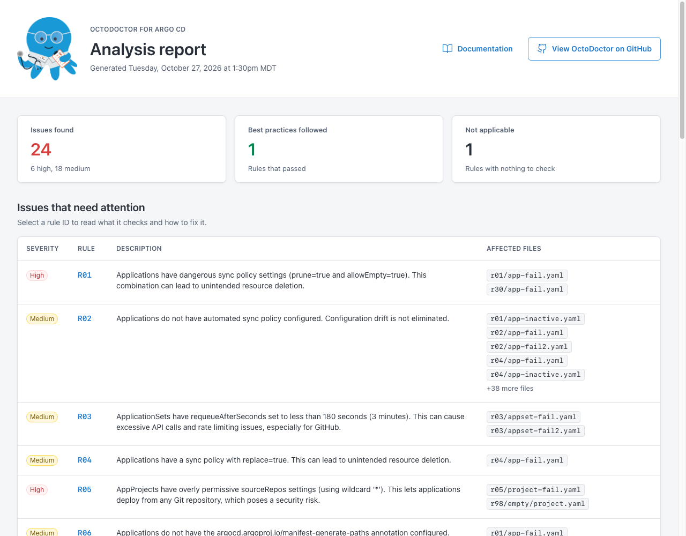

# OctoDoctor for Argo CD

OctoDoctor for Argo CD is a static analysis tool for Argo CD configuration. Point it at a directory of
YAML manifests and it inspects your Applications, ApplicationSets, AppProjects and Argo CD
ConfigMaps/Secrets, then reports misconfigurations and anti-patterns in your GitOps setup.

Every finding comes from a [rule](rules/index.md), and the results are written out as an HTML report
alongside machine-readable YAML and JSON.

!!! note "This page is a placeholder"
    TODO: expand this introduction with the full story — what problems the tool catches, who it is for,
    and how it fits into an Argo CD workflow.

## Example report

## Next steps

- [Install OctoDoctor](installation.md)
- [Browse the detection rules](rules/index.md)
