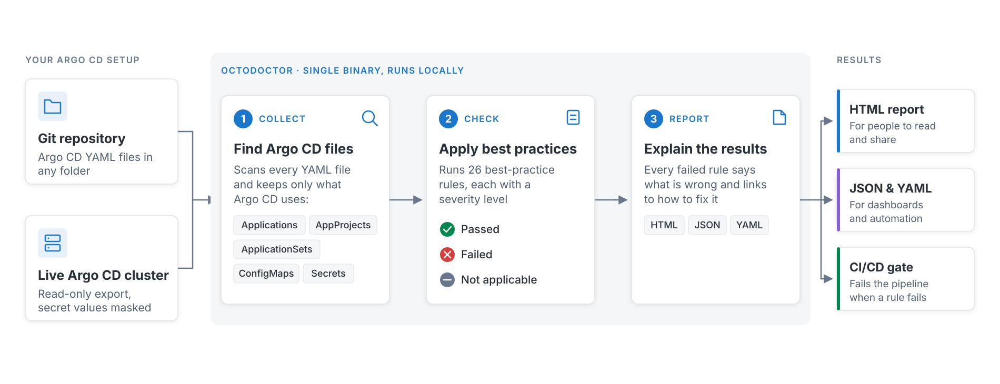

# OctoDoctor for Argo CD

OctoDoctor for Argo CD is a static analysis tool for Argo CD configuration. Point it at a directory of
YAML manifests and it inspects your Applications, ApplicationSets, AppProjects and Argo CD
ConfigMaps/Secrets, then reports misconfigurations and anti-patterns in your GitOps setup.

Every finding comes from a [rule](rules/index.md), and the results are written out as an HTML report
alongside machine-readable YAML and JSON.

You can use the tool in two modes:

- Read local Argo CD manifests (-d argument)
- Export from Live Argo CD cluster (-k argument)

In the latter case the Argo CD cluster will be reached via your current kubeconfig.

OctoDoctor will analyze your files or cluster and create a report in HTML/json/yaml format

## Example report

Here is an example for the HTML report.

## Next steps

- [Install OctoDoctor](installation.md)
- [Browse the detection rules](rules/index.md)
